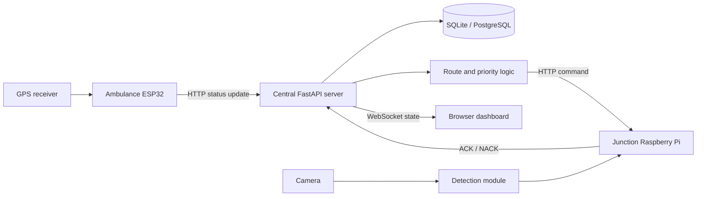

# RescueGrid architecture

## System context

RescueGrid is a prototype composed of four main subsystems. It is intended for controlled demonstrations and research, not direct control of public-road traffic.

## Component responsibilities

- **Ambulance unit** (`ambulance_unit/`): reads NMEA GPS data, maintains a priority toggle, and posts location/status payloads to `/ambulance/update`. Wi-Fi is attempted first; a SIM800L AT-command path is present as fallback. Verify behavior on the target ESP32 and modem.
- **Central server** (`central_server/`): validates incoming data with Pydantic, persists telemetry, calculates route/ETA information using a demonstration graph, manages priority requests, sends junction commands, processes acknowledgments, and streams state to dashboard clients.
- **Junction unit** (`junction_unit/`): exposes a command endpoint, runs a signal-driver abstraction and watchdog, and optionally initializes a camera detector. Actual detection and GPIO behavior depend on model files and wiring.
- **Dashboard** (`dashboard/`): uses Leaflet for the map and a WebSocket connection for ambulance/junction status. The server URL is currently configured in `dashboard/app.js`.

## Main data flow

1. The ambulance creates a status payload with its ID, priority flag, criticality, timestamp, and GPS fields.
2. The server validates the payload and stores the latest ambulance record and GPS log.
3. Route and priority components can calculate upcoming junctions and priority winners using configured graph data.
4. The signal controller sends a command to a configured junction endpoint.
5. The junction reports an acknowledgment back to the server.
6. The server broadcasts current state to connected dashboard clients.

Actual end-to-end flow depends on junction registration, road graph data, database records, model files, network addresses, and hardware configuration. Do not assume the full flow works simply because individual modules exist.

## Trust boundaries and safety

- The ambulance, server, junction, database, and browser are separate trust zones.
- CORS restricts browser origins but does not authenticate clients. Current API/junction command paths do not implement a complete authentication and authorization system.
- Use an isolated lab network until authentication, TLS, command freshness/replay protection, access control, audit review, and deployment hardening are implemented.
- A software watchdog is not a certified traffic controller. Never test on live traffic infrastructure.
